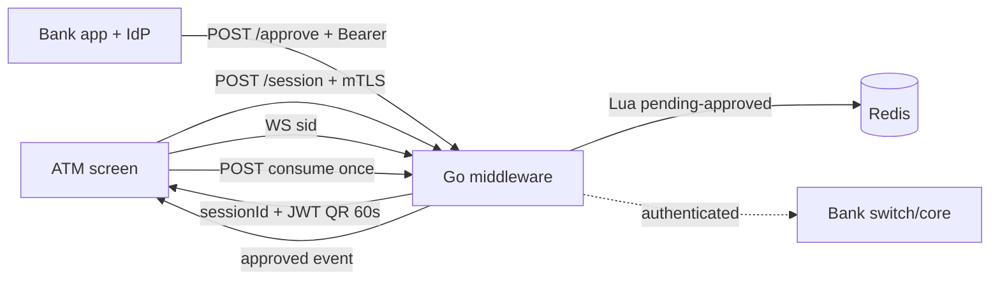
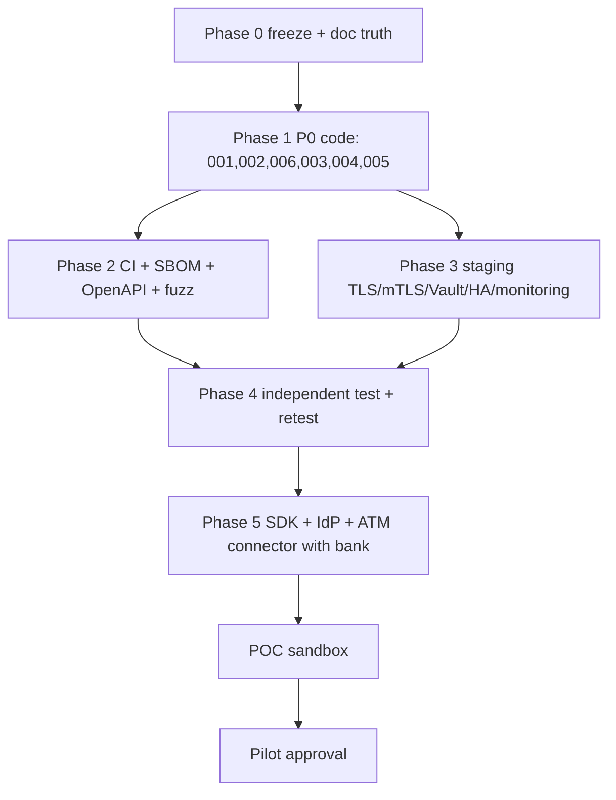

# BANK CODE READINESS GAP ANALYSIS
## QR-Based ATM Pre-Authorization Middleware — Code That Could Fail a Bank Assessment

**Repository:** `D:\myapps\ATM`, branch `main`, HEAD `de30cba` (3 commits, clean tree)
**Inspection date:** 2026-10-15 (UTC)
**Role:** Secure-code review + pen-test readiness + documentation-readiness assessment. Not a penetration test, not a certification, not legal advice.
**Companion document:** `BANK_READINESS_AND_PILOT_PLAN.md` (program-level roadmap). This file is the **code-level** gap register.
**v1 scope respected:** QR-only session authorization. No OTP/SMS/biometric-matching/NFC/ledger work is prescribed unless needed to close a security hole.

> Evidence rule: a README claim, code comment, hardening-plan checkbox, or self-written verification report is not implementation. Every finding below cites the file, symbol, and line range that was actually read.

---

## 1. Executive Summary

The middleware idea is sound — short-lived, single-use, ATM-bound QR authorization with handoff to existing bank infrastructure — but the **code enforces only part of it**. A bank assessor or independent tester working from the code (not the docs) would report Critical/High findings and refuse a pilot until the P0/P1 items are fixed and proven.

Confirmed P0 code blockers (each blocks demo-to-bank-security and everything downstream):

1. `CODE-001` — JWT strict-validation bypass: `backend-go/internal/session/jwt.go:76-98` lenient fallback drops `iss`/`aud` enforcement.
2. `CODE-002` — Dual-algorithm + dev-secret path still compiled: `jwt.go:39-42,52,64-68`, `config.go:99`, `backend-go/README.md:34`.
3. `CODE-003` — Self-asserted identity on approve: `handlers.go:231-241` + `mobile-app/App.tsx:174-178` (no IdP verification, defaults `demo-customer`).
4. `CODE-004` — Anonymous session creation + optional mTLS: `handlers.go:52-73` (defaults `ATM-DEMO-001`, header checked only if present).
5. `CODE-005` — Unauthenticated WebSocket + polling reads: `realtime/hub.go:64-68`, `cmd/server/main.go:71-74`, `handlers.go:132-144`.
6. `CODE-006` — Silent fail-open to memory/stdout: `cmd/server/main.go:42-62`, `audit/siem.go:54-61`.
7. `CODE-007` — Audit fail-open + weak immutability: `siem.go:93-117`, `migrations/001_create_audit_log.sql:46-53` (grants commented, `TRUNCATE` not revoked).

P1 items that would each be a High/Medium pen-test finding: in-process rate limiter with wrong thresholds (`CODE-008`), error-oracle on JWT (`CODE-009`), eviction-hijack on WS (`CODE-010`), plaintext data-layer transport/secrets (`CODE-011`), over-broad reads (`CODE-012`), unvalidated `kid`/no rotation (`CODE-013`), unpinned images + Go-version skew (`CODE-014`), no CI/SBOM-standard (`CODE-015`).

Documentation cannot be written truthfully today for: key custody (file/env, not HSM), device binding (client-supplied), ATM identity (optional header), audit immutability (trigger only), Redis-mandatory (fallback exists), SDK integration (`sdk.md` is 0 bytes), and SLA/RPO/RTO (no measurements). §13 lists every code→document mismatch with what must change versus what is writing-only.

Minimum to survive an independent test: fix CODE-001…CODE-007, add the regression suite in §17, run it in an isolated staging with test-only keys, then commission the test. Everything else is sequenced by gate in §19.

---

## 2. Scope and Assessment Method

### 2.1 What was reviewed vs what was not

Reviewed by reading (no code executed, no live systems touched):

* All Go handlers, router, rate limiter, config, entrypoint, session/JWT/store/Redis/Lua, realtime hub, audit logger, web embed, migrations, Dockerfile, compose, Nginx, cert scripts, tests, `go.mod`/`go.sum`.
* All ATM simulator source (`api.ts`, `App.tsx`, 3 components, configs) plus embedded build output existence check.
* All mobile source (`App.tsx` 377 lines, `app.json`, `package.json`, `babel.config.js`).
* All security-relevant docs: `README.md`, `HARDENING_PLAN.md`, `PEN_TEST_HARDENING.md`, `docs/ARCHITECTURE.md`, `API.md`, `RUN.md`, `STRIDE_THREAT_MODEL.md`, `PEN_TEST_VERIFICATION_REPORT.md`, `OPS_RUNBOOK_AND_SLA.md`, `DPA_DATA_RESIDENCY.md`, `SBOM_BACKEND.txt`, plus `HOW_TO_USE.html`, `PROJECT_REPORT.html`, `TEAM_WORK_SPLIT.html`, root `*.ps1`.
* Git metadata: 3 commits, no `.github/` workflows, `.gitignore` (correctly excludes `deploy/certs/*key/crt`).
* Grep for `dev-secret`, `TODO/FIXME`, `console.log`, hardcoded hosts, `ENABLE_AUDIT`/`AuditAPIEnabled`, CORS wildcards.

Not reviewed as proof: minified bundles under `backend-go/internal/web/static/assets/` (existence noted only), future ISO 8583/vendor code (does not exist — correctly not assumed), bank-side systems (out of repo).

### 2.2 How a conclusion was graded

* **Confirmed weakness:** code read shows the behavior (with path:lines).
* **Missing control:** no code found after searching all plausible locations + docs admit mock/placeholder.
* **Documentation mismatch:** doc statement quoted vs code behavior quoted.
* **Unverified assumption:** would need lab execution or bank input; marked as such, never stated as fact.
* **Not claimed as tested:** `go vet/test`, SAST/SCA/DAST, container scans, load tests were **not executed** here (`go`/`docker` absent — §22). Existing repo test files were read, not rerun.

---

## 3. Repository Components Inspected

| Component | Key files (all read) | Lines / notes |
|---|---|---|
| HTTP API | `backend-go/internal/httpapi/handlers.go:1-351`, `router.go:1-98`, `ratelimit.go:1-129` | Full logic incl. `CreateSession`, `GetSession`, `ApproveSession`, `ConsumeSession`, `Audit`, `Health` |
| Session/JWT | `internal/session/jwt.go:1-132`, `types.go:1-39`, `store.go:1-176`, `redis_store.go:1-217` | Lua scripts `:20-68`, fallback `:76-98` |
| Realtime | `internal/realtime/hub.go:1-211`, `hub_test.go:1-105` | `CheckOrigin:true` at `:68`, eviction `:105-113` |
| Audit | `internal/audit/siem.go:1-125`, `siem_test.go:1-51`, `migrations/001_create_audit_log.sql:1-53` | Async insert `:93-117`, trigger `:33-44`, grants commented `:46-53` |
| Config/boot | `internal/config/config.go:1-187`, `cmd/server/main.go:1-121`, `internal/web/web.go:1-71` | Env defaults, ephemeral key `:32-40`, fallback `:50-61` |
| Tests | `httpapi/handlers_test.go:1-195`, `session/jwt_test.go:1-65`, `session/store_test.go:1-78` | 5 handler tests + JWT/state tests; Redis/Lua, IdP, mTLS, race tests absent |
| ATM UI | `atm-simulator/src/api.ts:1-119`, `App.tsx:1-191`, `components/AtmFrame.tsx`, `ScanFrame.tsx`, `CheckMark.tsx`, `package.json`, `vite.config.ts` | `BASE` fallback `:12-16`, `ws` derive `:68`, QR value `App.tsx:137` |
| Mobile | `mobile-app/App.tsx:1-377`, `app.json:1-28`, `package.json:1-30` | Hardcoded `http://192.168.108.213:4000` at `:24`, no Bearer `:167-178`, pinning commented `:179-191` |
| Infra | `backend-go/Dockerfile:1-54`, `docker-compose.prod.yml:1-134`, `deploy/nginx/nginx.conf:1-168`, `deploy/generate-mtls-certs.ps1:1-82` + `.sh`, `deploy/certs/README.md` | `golang:1.23` vs `go 1.26.0`, `sslmode=disable` at compose `:35`, mTLS `ssl_verify_client on` at nginx `:85` |
| Docs | `README.md:1-26`, `HARDENING_PLAN.md:1-127`, `PEN_TEST_HARDENING.md:1-151`, `docs/ARCHITECTURE.md:1-87`, `API.md:1-77`, `RUN.md:1-87`, `STRIDE…`, `PEN_TEST_VERIFICATION_REPORT.md:1-90`, `OPS_RUNBOOK…`, `DPA…`, `SBOM_BACKEND.txt:1-16`, `sdk.md` (0 bytes) | Overclaim pattern: `Certified / PASSED ✅ / MITIGATED ✅` with no independent evidence |
| Meta | `go.mod:1-18`, `go.sum` (18 lines), `.gitignore:1-34`, `test-demo.ps1`, `start-server.ps1`, `env-m-drive.ps1`, `run-tests-m-drive.ps1` | `JWT_SECRET dev-secret-change-me` in `backend-go/README.md:34` |

---

## 4. Current Implementation Versus Intended Architecture

Intended (from `docs/ARCHITECTURE.md:26-47` + task §2): ATM creates session → signed ATM-bound QR → bank-app scan → IdP-authenticated approve → atomic `pending→approved` → WS push → single `consume` → handoff to switch/core.

Actual deltas (each is a CODE finding in §16):

| Step | Intended enforcement | Actual code | Gap |
|---|---|---|---|
| 1. Create | Authenticated ATM, registered `atmId` | `handlers.go:52-55` defaults empty to `ATM-DEMO-001`; `66-73` checks `X-Client-Cert-DN` only if header present | CODE-004: anonymous minting |
| 2. QR bind | RS256, `iss/aud/exp/kid`, `atm+sid` bound | `jwt.go:21-45` signs correctly, but `50-98` verifies with fallback that drops `iss/aud`; `kid` never allowlisted | CODE-001/002/013 |
| 3–4. Approve identity | Bank IdP + enrolled device | `handlers.go:231-241` derives `demo-customer`/`verified-bank-user` from optional header; mobile sends `deviceId:demo-device-001` + free-text `customerRef` | CODE-003 |
| 5. Atomic single-use | Lua single-winner across replicas | Lua correct (`redis_store.go:20-68`) **iff** Redis used; `main.go:50-61` silently uses memory otherwise | CODE-006 |
| 6. Push isolation | Only owning ATM learns result | `hub.go:68` any origin; `main.go:71-74` checks existence only; second subscriber evicts first | CODE-005/010 |
| 7. Consume once | ATM-authenticated, idempotent commit | `handlers.go:289-321` checks state only, no ATM auth, no idempotency key | CODE-004/005 |
| 8. Handoff | Switch/core contract | No connector exists; simulator `withdraw()` just animates (`atm-simulator/src/App.tsx:85-93`) | Integration gap §11, not a vuln |

Net: steps 2/5 logic is right in isolation; steps 1/3/4/6/7 trust the caller.

---

## 5. High-Priority Code Changes

Fix in this order (dependencies noted). Each row is expanded in §8 and registered in §16.

| Order | ID | Change (one line) | Files | Blocks |
|---|---|---|---|---|
| 1 | CODE-001 | Delete JWT lenient fallback; enforce `iss/aud/RS256/kid` strictly | `session/jwt.go:76-98`, `jwt_test.go` | Demo to security |
| 2 | CODE-002 | Prod RS256-only, refuse dev secret, remove default | `jwt.go:39-42,52`, `config.go:89-101`, `backend-go/README.md:34` | Demo to security |
| 3 | CODE-006 | Fail closed without Redis/PG in prod; add `/readyz` | `cmd/server/main.go:42-62`, `audit/siem.go:54-61` | Staging truth |
| 4 | CODE-003 | Require + verify IdP Bearer; derive identity server-side | `handlers.go:231-257`, mobile `App.tsx:167-178`, new `internal/idp/` | POC connection |
| 5 | CODE-004 | Require mTLS ATM identity + registry; remove default `atmId` | `handlers.go:47-82,289-321`, `config.go`, Nginx | POC connection |
| 6 | CODE-005/010 | Authenticate WS/poll reads; reject-second-takeover | `hub.go:56-116,180-189`, `handlers.go:132-144`, `api.ts` | POC connection |
| 7 | CODE-007 | Audit outbox (fail-closed) + least-privilege + hash chain | `siem.go:69-118`, `migrations/002_*.sql` | Pilot evidence |
| 8 | CODE-008 | Distributed rate limits + trusted-proxy fix | `ratelimit.go`, `main.go:81`, `nginx.conf:49-50` | Pilot abuse resistance |

P1 follow-ons (CODE-009…CODE-015) run in parallel once the above land — §8, §18.

---

## 6. Security Controls That Are Missing or Not Enforced

| Control | Claimed | Code reality | Pen-test consequence |
|---|---|---|---|
| Bank-user authentication | `ApproveSession` “bank IdP token” (`PEN_TEST_HARDENING.md:29`) | Header *observed* only (`handlers.go:233-238`); no JWKS/sig/`iss`/`aud`/`exp` check | **Critical:** auth bypass — approve victim session as attacker (M-02). |
| Device binding | “`deviceId` recorded” (`ARCHITECTURE.md:64`) | `deviceId` taken verbatim (`handlers.go:165,244`), hardcoded `demo-device-001` from phone | **High:** device spoof/clone; no enrolment to test. |
| ATM authentication | “mTLS `CN=ATM-*`” (`STRIDE:37`) | Optional header substring (`handlers.go:66-73`); direct-to-Go bypasses Nginx entirely | **High:** rogue session minting, terminal impersonation. |
| WS authorization | “single-subscriber prevents eavesdrop” (`STRIDE:40`) | Existence check only (`main.go:71-74`); second conn evicts first (`hub.go:106-113`) | **High:** takeover/DoS oracle; takeover test becomes a finding. |
| Read authorization | Implicit least-privilege | `GET /session/:id` returns full JSON anon (`handlers.go:132-144`); `GET /audit` gated by env flag only | **High (IDOR/enumeration)** + privacy leak. |
| Rate-limit/lockout | “10 approve/min/IP + 5 fails→5 min lock + 30/min/ATM” (report `:26`) | Single global `60/min` (`main.go:81`), per-process map (`ratelimit.go:17-23`), trusts `X-Forwarded-For` (`:113-122`) | **Medium/High:** bypass by rotation/scale; thresholds unenforceable. |
| Strict input | “strict parsing, regex” | `atmId` regex present, but `CreateSession` ignores decode errors (`handlers.go:51`), no body cap, unknown fields allowed, no CT enforcement | **Medium:** fuzz/DoS findings. |
| Error secrecy | Professional errors assumed | `invalid_token` echoes `err.Error()` (`handlers.go:183`) | **Medium:** parser oracle. |
| Secure defaults | “fail fast, no dev secrets” | Dev default `dev-secret-change-me` (`config.go:99`), localhost CORS defaults (`router.go:47-49`, `config.go:42`), HTTP/WS documented (`RUN.md`, `api.ts:12-16,68`) | **Medium:** prod misconfig → downgrade. |
| Fail-closed deps | “Redis/PG mandatory” | Warn-and-continue (`main.go:53-61`, `siem.go:56-61`) | **High:** split-brain + audit loss. |
| Audit integrity | “append-only, SIEM” | Async fire-and-forget (`siem.go:93-117`); grants commented (`001.sql:46-53`) | **High:** repudiation; DBA-modify finding. |

Controls enforced only in frontend (and therefore not controls): mock biometric gate (`App.tsx:254-256,303-305`), screen shield (`:98-113`), root heuristic (`:51-65`), ATM page hiding (none — token in `QRCodeCanvas value`). All must be re-anchored server-side per §8.

---

## 7. QR/JWT and Session Lifecycle Implementation Gaps

### 7.1 JWT (`internal/session/jwt.go`)

* **CODE-001 (P0):** fallback `jwt.Parse` at `:76-98` re-validates tokens that failed the strict parser (`WithIssuer/WithAudience` at `:51-55`). A token with valid signature but missing/wrong `iss`/`aud` passes the second path with only expiry + `sid`/`atm` presence checks (`:119-129`). Fix: delete `:74-98`, keep one parser. Invariant: *no token without `iss=bank-auth-server`, `aud=atm-auth`, valid RS256 sig by pinned key, and `exp` within skew verifies.*
* **CODE-002 (P0):** `WithValidMethods(["RS256","HS256"])` (`:52,94`) + HS256 sign path (`:39-42`) + dev secret default. Fix: prod parser `["RS256"]` only; refuse non-empty `JWTSecret` when `ENV=prod`; remove `backend-go/README.md:34` default from docs.
* **CODE-013 (P1):** `kid` written (`:33-35`) never validated. Fix: `JWT_KIDS` allowlist + JWKS rotation (dual-publish 120 s, revocation list). Tests: unknown/rotated/revoked `kid`.
* Minor gaps: no `nbf`, no future-`iat` rejection, `MaxClockSkewSeconds=30` applied only to `exp` (`:127`), not `iat`. Fix with `iat ≤ now+skew` + `nbf` support.

### 7.2 Lifecycle (`store.go`, `redis_store.go`, `handlers.go`)

State machine itself is correct: `TransitionToApproved` requires `pending` + unexpired (`store.go:74-83`, Lua `redis_store.go:27-36`); `TransitionToConsumed` requires `approved` (`store.go:106-108`, Lua `:59-61`). Gaps are around it:

* **Binding TOCTOU:** `VerifyQR → Get → atm/sid compare → Transition` (`handlers.go:178-257`) is non-atomic; Lua does not recheck `atm`. Fix: pass expected `atm` into Lua and fail `ERR_ATM_MISMATCH` inside the script (§8.3).
* **Error-string coupling:** `handlers.go:249` matches `"EXPIRED"` substring from Lua/Go errors. Fix: typed errors (`ErrExpired/ErrConflict/ErrAtmMismatch`) from both stores.
* **Expiry sources disagree:** JWT `exp` (seconds) vs `ExpiresAt` (ms) vs Redis TTL (`SESSION_TTL`) vs sweeper 5 s (`store.go:150-174`) vs Redis no-op sweeper (`redis_store.go:211-213`). `Get` lazy-expire rewrites with `KeepTTL` (`:135-139`) so the key can outlive logical expiry. Fix: single `nowMillis()` source per request, `Put` TTL = `ExpiresAt-now` (not fixed TTL), document that `expired` audit fires on access (or add keyspace-notification sweeper).
* **`Put` overwrite:** `SET` without `NX` (`redis_store.go:116`) + `map` overwrite (`store.go:40-45`) — UUIDv4 collision should be impossible; assert with `NX` and alert on collision (RNG health signal).
* **Unbounded audit slices** (`store.go:135-148`, `redis_store.go:195-207`) — memory DoS; fix with bounded ring + counter (§8.4).
* **Poll/WS divergence:** `api.ts` polls every 1.5 s on WS close (`atm-simulator/src/App.tsx:55-73`) while `Notify` sends full `Session` including PII (`hub.go:180-189`). Fix: minimal `{type,sid,status,atmId}` over WS; full object only on authenticated `GET`; single status store on ATM page.

Existing tests that genuinely help (keep + extend): `TestStoreStateTransitions` (double-approve/double-consume `CONFLICT`), `TestStoreExpiredSessionRejection`, `TestApproveSessionAtmMismatchRejected`, `TestRS256SignAndVerify`/`TestVerifyQRExpired`, `TestHubSingleSubscriberEviction` (today asserts eviction — must be rewritten to assert reject-second after CODE-010 fix).

---

## 8. Redis, PostgreSQL, and Distributed-State Requirements

### Redis — what must change in code/config (CODE-006/008 + Lua hardening)

1. `cmd/server/main.go:42-62`: when `ENV=prod`, `REDIS_URL` empty/unreachable/script-load failure → `log.Fatalf`, not fallback. Add `REDIS_REQUIRED=true` default-true in prod. Expose `/readyz` (Redis `PING` + script SHA present).
2. `redis_store.go` Lua: add `expectedAtm` argv check; reject empty `deviceId`; return machine-readable codes. Change `Put` to `SET NX EX` with per-session TTL (`ExpiresAt-now`, clamped 10–300 s). Keep `EvalSha`→`Eval` fallback but count `redis_script_fallback_total`.
3. Rate limiting moves to Redis (CODE-008): `SET NX EX 60 + INCR` per `rl:approve:{ip}:{window}` and `rl:session:{atm}:{window}` with the documented 10/30 thresholds (not global 60). `getClientIP` (`ratelimit.go:113-129`) must use the leftmost untrusted hop only after `set_real_ip_from` for Nginx in `nginx.conf`; never trust client-supplied `X-Forwarded-For` directly.
4. Deploy: `rediss://` + ACL user limited to `atm:session:*` + scripting; Sentinel/Cluster (runbook claims `<3 s` failover — unproven); `maxmemory` + `noeviction` (fail loudly, alert) instead of `volatile-ttl` silent drops (`compose:66-67`); AOF policy decision recorded with RPO math (`everysec` vs `always`).

### PostgreSQL — what must change (CODE-007)

1. New `migrations/002_audit_hardening.sql`: separate `audit_owner` vs `atm_auth_app` (`INSERT,SELECT` + sequence only; `REVOKE TRUNCATE, UPDATE, DELETE`; revoke from `PUBLIC`; `ALTER TABLE … OWNER TO audit_owner`); `prev_hash/hash` chain via `pgcrypto`; `audit_outbox` table for fail-closed writes; retention partitions.
2. `siem.go:69-118`: synchronous outbox insert in the request path (or durable Redis Stream when PG down) + relay worker; return `503 audit_unavailable` instead of `200` when ack times out. Add `request_id`, `key_id`, `idp_sub_hash`, `tls_client_dn`; hash `customerRef/deviceId/IP` for long-term storage; assert marshalled JSON never contains `qrToken`/`eyJ`.
3. Backup/PITR + encrypted restore drill (no code, but `002` must be restore-tested; record RPO/RTO clocks — replaces `OPS_RUNBOOK` assertions).

External tasks (not code): VPC/TLS certs for data layer, KMS-encrypted volumes, `pgaudit` on, DDL logging, quarterly access reviews.

---

## 9. Audit Logging and Evidence-Generation Gaps

Coverage today: `session.created/approved/consumed/expired`, `approve.atm_mismatch/rate_limited` (`handlers.go:108-120,201-220,263-282,309-317`). Missing security events with no code path: `approve.invalid_token`, `approve.device_mismatch` (post-CODE-003), `consume.conflict`, `ws.subscribe/reject/takeover_attempt`, `tls.client_cert_fail` (only in Nginx logs, uncorrelated), `config.fail_closed`, `key.rotation`, `redis.fallback_refused`, `audit.dropped_queued`.

Forensic blockers:

* No `request_id` propagated (`X-Request-ID` absent in `nginx.conf:101-108,152-156` and `writeJSON/writeErr` in `handlers.go:30-42`) — cannot join Nginx ↔ Go ↔ PG ↔ SIEM for one attempt.
* Timestamps from `time.Now()` per call site (`nowMillis()` in two packages) with no NTP requirement — skew disputes possible. Fix: single request clock + `chrony` + monotonic `ts_milli` already in schema (`001.sql:11`).
* PII in cleartext (`device_id`, `customer_ref=user.name`, `client_ip` in `siem.go:23-28`, `001.sql:16-19`) contradicts `DPA_DATA_RESIDENCY.md:20-25` zero-PII stance once `customerRef=Ali Hassan` is used in tests/scripts (`handlers_test.go:116`, `test-demo.ps1`). Fix: opaque hashes + retention schedule before any bank data.
* SIEM delivery has no ack: stdout for forwarder + async PG (`siem.go:83-117`). Forwarder absent from compose; PG error only logged. A `session.approved` can exist without any durable audit row. Fix per §8 (outbox + alert `audit_lag_seconds`).

---

## 10. Cryptography, Key Management, Device Identity, and mTLS Gaps

| Area | Code today | Gap type | Required target |
|---|---|---|---|
| Signing key | Env/file PEM (`config.go:49-83`), ephemeral RSA-2048 per boot in non-prod (`main.go:32-40`), HSM/KMS only mentioned in docs | Placeholder integration | Prod: KMS/HSM signer interface (`internal/kms Signer`), key never in env; file path only for staging with `0400` + ownership check; startup prints SHA-256 fingerprint, never key. |
| Missing/malformed key | Prod fatals without RSA (`config.go:89-95`) — good; dev silently creates/falls back (`:97-101` + `main.go:32-40`) | Safe if isolated | Add `ENV=prod` self-test refusing `JWTSecret!=""`, localhost origins, `http` base; dev banner `EPHEMERAL-KEY`. |
| Rotation/revocation | `KeyID` env (`config.go:44`), header echo (`jwt.go:33-35`), no JWKS/allowlist/grace | Missing control | `JWT_KIDS` + JWKS URL, dual-publish 120 s, revocation endpoint, rotation drill log. |
| Device identity | Client string, no enrolment (`handlers.go:165`) | Missing control | Enrolment API issuing Keystore/Keychain-bound key; `deviceId` = enrolled key fingerprint; attestation (Play Integrity/App Attest) verified server-side. |
| ATM identity | Regex + optional header (`handlers.go:20,66-73`) | Not enforced | mTLS `CN=ATM-*` allowlist + registry DB + per-terminal cert (`generate-mtls-certs` per-device, unique CN, inventory CSV, CRL). |
| TLS verify | Nginx TLS1.3 `X25519…` (`nginx.conf:61-68`) good; Go plain HTTP (`main.go:102-108`); mobile pinning commented (`App.tsx:179-191`); ATM `ws` downgrade possible (`api.ts:68`) | Partial/half-terminated | Go binds loopback only; Nginx sole ingress; HSTS preload; refuse `ws://` unless loopback; implement pinning in SDK (SPKI + `network_security_config`/ATS). |
| Cert lifecycle | CA 4096-bit + leafs 2048-bit + SANs (`generate-mtls-certs.ps1:31-69`) good; rogue cert for negative test good; script `exit 0` without openssl (`:17-26`); no CRL/OCSP/rotation | Procedure gap | `set -e`/`exit 1`, fingerprint print, `ssl_crl` + OCSP, rotation playbook with `<15 min` revocation drill. |

HSM/KMS verdict: **claimed as future, correctly absent from code** — but docs imply readiness (`HARDENING_PLAN.md:31-35`). Either implement the `Signer` interface or downgrade docs to `file-based staging keys — HSM required before pilot` (CODE-022).

---

## 11. Mobile Application and ATM Integration Readiness

### Mobile (`mobile-app/`) — mockup, not shippable SDK

* Mock auth: `Log in with Face ID (mocked)` (`App.tsx:254`), `Approve with biometrics (mocked)` (`:303-305`), free-text `customer` (`:236`) + hardcoded balance (`:264`) — must never reach bank review without `DEMO` watermark (CODE-016 blocks demo-to-security if shipped as-is).
* Transport: default `http://192.168.108.213:4000` (`:24,243`), HTTPS only when env flag set (`:23,28-41`). Fix: default `ENFORCE_HTTPS=true`, refuse `http://` unless `__DEV__`+loopback.
* Token hygiene good-in-JS (`qrTokenRef` RAM-only `:79-81`, cleared `:205-207,309`, background clear `:118-127`) but JS memory ≠ enclave; no `SecureStore`, no `Authorization` header (`:167-178`), pinning deferred to comments (`:179-191`), root check is `isRootedExperimentalAsync()` (`:51-65`, bypassable), shield is Expo-level (`:98-113`, ADB/external-camera bypass).
* Config: `app.json` lacks `bundleIdentifier`/`versionCode`, `usesCleartextTraffic=false`, `FLAG_SECURE`, ATS; no release-signing/attestation wiring.

Ownership split: bank app owns login/biometric/IdP; **SDK owns** `scanQR/approve/enrolDevice` + pinning + attestation + secure transport; **backend owns** all authorization (never trust SDK verdict). Do not build a standalone customer app — build `sdk/` (`.aar/.xcframework`) + thin sample (CODE-016, blocks POC).

### ATM (`atm-simulator/`) — browser demo, not a connector

* `BASE` fallback to `http://localhost:4000` (`api.ts:12-16`), WS `http→ws` (`:68`) — fine for lab, forbidden for bank review unless loopback + banner.
* QR `value={session.qrToken}` (`App.tsx:137`) — readable via DevTools by design (QR must be scannable). The `mask token in DOM` claim (`api.ts:1-8`) is therefore **unimplementable** for a QR; replace with photograph-accepted threat model + TTL/single-use/monitoring (CODE-017).
* Polling 1.5 s vs WS race (`App.tsx:42-73`) converges but both write `approved`; production ATM needs single commit on `consume` with idempotency.
* No mTLS from browser JS, no terminal enrolment, `atmId` defaults `ATM-DEMO-001` (`api.ts:35`), `withdraw()` is animation (`App.tsx:85-93`). Lab-demo OK; bank POC needs a **named** connector (switch-API adapter preferred; terminal XFS agent; or hardened kiosk browser) + per-terminal CN + handoff contract. Do **not** build generic ISO 8583 — wait for the bank's interface spec (dependency, §18).

---

## 12. Deployment and Production Configuration Gaps

Code defect vs config gap is separated below (both block, different owners):

| # | Issue | Type | Fix location |
|---|---|---|---|
| CODE-011a | `sslmode=disable` (PG), `redis://` (no TLS) | Config (P1) | `docker-compose.prod.yml:34-35` → `sslmode=verify-full` + `rediss://`, Vault secrets |
| CODE-011b | Plaintext `bank-secure-*-pass` in compose | Config (P1) | Compose secrets / Vault Agent; no defaults in repo |
| CODE-018 | Go listens `0.0.0.0:4000` plain HTTP; no redirect/HSTS origin | Code+config (P1) | `main.go:92-108` bind loopback + `REQUIRE_MTLS_HEADERS`; Nginx sole TLS; document termination |
| CODE-012 | `GET /audit` env-flag only; `GET /health` leaks `env` | Code (P1) | `handlers.go:323-344` + mTLS role + network policy; strip `env` |
| CODE-014 | Images unpinned (`:latest`-adjacent tags), `golang:1.23` vs `go 1.26.0` | Code/config (P2) | Pin digests, align toolchain, `cosign`, `.dockerignore` |
| CODE-019 | No `readOnlyRootFilesystem`, `cap_drop`, `no-new-privileges`, tmpfs; single replica; no readiness split | Config (P2) | Compose/K8s securityContext, `backend ×2`, `/livez` vs `/readyz` |
| CODE-020 | Nginx allows `approve` via ATM `:443` (all `/api/`) while mobile `:8443` restricts to `approve+health` — segmentation bypass; no `ssl_crl`/OCSP | Config (P2) | `nginx.conf:95-109 vs 148-157`; add CRL/OCSP + consistent IdP check |
| CODE-021 | `HEALTHCHECK wget …` may not exist in minimal image; no resource reservations; log correlation missing | Config (P3) | `Dockerfile:51-52` busybox/`wget` pin or Go health binary; add `X-Request-ID` |
| Backup/DR | No job, encryption, or restore test backing `RPO 15m/RTO 1h` | Procedure (P1 for pilot) | Add jobs + quarterly timed restore (evidence, not code) |

Startup must refuse prod without: RSA/KMS, JWKS reachable, Redis+PG reachable over TLS, bank `ALLOWED_ORIGINS`, `REQUIRE_MTLS_HEADERS`, `ENABLE_AUDIT_API=false` (CODE-006/018/020 acceptance).

---

## 13. Code-to-Documentation Mismatches

| Doc claim | Code contradiction | Doc fix vs code fix | Blocks |
|---|---|---|---|
| `HARDENING:3-6`, `PEN_TEST:1-6` “100% Certified Production Ready” | No independent test, no cert body; 7 P0s open | Doc: replace with `Demo + hardening in progress → this analysis`; Code: none (truth first) | **Gate A** |
| `PEN_TEST:64` “`WithValidMethods([RS256])`” | Code allows `RS256+HS256` (`jwt.go:52,94`) | Doc: correct to dual (then to RS256-only after CODE-002); Code: CODE-002 | Gate A/B |
| “No dev secrets / fail fast” | `config.go:99` reintroduces `dev-secret`; `README:34` publishes it | Doc: remove default; Code: CODE-002 | Gate A/B |
| “IdP token required” (`PEN_TEST_HARDENING:29`) | Header optional (`handlers.go:233-238`) | Doc: mark `planned`; Code: CODE-003 | Gate C |
| “mTLS enforced” (`STRIDE:37`) | Header-optional (`handlers.go:66-73`), Go reachable directly | Doc: `Nginx-terminated, not app-enforced`; Code: CODE-004/018 | Gate C |
| “Atomic Lua, no double-spend” | True **iff** Redis; fallback breaks it (`main.go:50-61`) | Doc: add `requires REDIS_URL, fail-closed`; Code: CODE-006 | Gate B |
| “30/min/ATM, 10/min/IP + lockout” | Global 60/min, memory-only (`main.go:81`, `ratelimit.go`) | Doc: correct thresholds post-fix; Code: CODE-008 | Gate C |
| “Audit disabled in prod, SIEM-only” | Flag-only, no role/network (`handlers.go:323-332`) | Doc: add role+policy; Code: CODE-012 + PG roles | Gate C |
| “Append-only / tamper-proof” | Grants commented, `TRUNCATE`/owner bypass (`001.sql:46-53`) | Doc: downgrade to `trigger-guarded`; Code: CODE-007 | Gate D |
| “HSM/KMS” | File/env only (`config.go:49-83`) | Doc: `file-based staging`; Code: KMS interface (or defer with label) | Gate D |
| “Device binding” | Client string (`handlers.go:165`) | Doc: `recorded, not verified`; Code: CODE-003 enrolment | Gate C |
| “WSS-only, no DOM leak” | `ws://` over HTTP possible; QR in props (`api.ts:68`, `App.tsx:137`) | Doc: accept photograph model; Code: CODE-005/017 | Gate C |
| “SDK integration” | `sdk.md` empty; Expo mockup only | Doc: roadmap; Code: `sdk/` (CODE-016) | Gate C |
| “RPO/RTO/SLA/capacity” (`OPS_RUNBOOK:15-19`) | No jobs/measurements | Doc: retitle `targets + test plan`; Code: benchmarks (no feature) | Gate D/Prod |
| “`go vet` clean, tests 100%” (`PEN_TEST:89-90`) | No logs, toolchain absent here | Doc: attach SHA-tagged logs from CI; Code: CI (CODE-015) | Gate B |

Rule: **doc correction ≠ remediation.** Both columns must close; closing docs alone changes no finding status.

---

## 14. Penetration-Test Readiness Assessment

### Can a test be scoped today? Barely — and it would fail fast on P0s.

| Readiness element | State | Needed before commissioning |
|---|---|---|
| Frozen target (SHAs, OpenAPI, config) | ❌ No OpenAPI, no digests, no staging values file | `docs/openapi.yaml` + `docker-compose.staging.yml` + version index (CODE-015) |
| Test accounts/certs/data | ⚠️ Only demo names (`ATM-DEMO-001`, `Ali Hassan`, `demo-device-001`) | Synthetic IdP users, `ATM-TEST-*` certs, `request_id` correlation (CODE-003/004) |
| Auth model to test against | ❌ Optional headers | Enforced IdP + mTLS (CODE-003/004/005) or SOW states `auth-not-enforced — test bypass` (wastes budget) |
| State-machine oracle | ⚠️ Logic right, fallback wrong | Fail-closed Redis (CODE-006) + typed errors, else race tests are nondeterministic |
| Audit oracle | ❌ Fail-open, PII-mixed | Outbox + redaction (CODE-007) or findings cannot be disputed |
| Rate-limit oracle | ❌ Memory/global | Distributed limits (CODE-008) or DoS tests are meaningless across replicas |
| Mobile target | ❌ Expo Go mockup | Signed release binary or SDK sample (CODE-016) for MASVS |
| Rules/contract | ❌ No ROE/SOW template in repo | Add §15-style SOW + auth letters (companion plan) before inviting testers |

### Tests that must pass in staging first (else the paid test just re-finds them)

JWT matrix (wrong iss/aud/kid/alg-none/HS256/expired/skew±31/tampered) · cross-ATM/sid reuse · attacker-approves-victim (must `401` post-fix; today `200` — record as pre-fix fail) · double-approve/consume ×50 concurrent ×2 replicas · WS anon/takeover/idle/reconnect · Redis-kill/PG-kill/restart recovery · poll/WS agreement · header/CORS/TLS matrices · MASVS proxy-with-test-CA. Full matrix with expected outcomes is in the companion plan §9/§14 — each maps to a CODE ID in §16.

Existing tests worth keeping (not sufficient): `TestApproveSessionAtmMismatchRejected`, `TestStoreStateTransitions`, `TestVerifyQRExpired`, `TestHubSingleSubscriberEviction` (rewrite to reject-second), `TestSecurityHeadersPresent` (extend to full header/CORS set).

---

## 15. Bank Assessment and Vendor-Review Blockers

What each bank function would flag, in their language:

* **CISO / AppSec:** auth bypass (CODE-003/004/005), JWT bypass (CODE-001/002), audit repudiation (CODE-007), findings without retest. *Needs:* enforced authN/Z + strict crypto + outbox audit + independent report.
* **Architecture:** trust boundary terminates at Nginx but Go accepts direct anonymous calls; WS/poll oracles differ. *Needs:* loopback bind + mTLS-header requirement + minimal WS payload.
* **IAM:** no IdP integration, no device enrolment, no `kid` lifecycle. *Needs:* OIDC + enrolment + rotation drill.
* **Infra/Cloud:** plaintext secrets, no data-layer TLS, unpinned images, no readiness split, no backup proof. *Needs:* Vault/KMS, `rediss`/`verify-full`, digests, `/readyz`, timed restore.
* **SOC:** ECS-ish JSON but no parser pack, no `request_id`, PII-mixed, no ack/alert. *Needs:* SIEM guide + ack + retention + 72-h BB-reporting path (via bank).
* **Privacy/DPO:** `customerRef` free text + IP/device in cleartext vs zero-PII claim. *Needs:* inventory + hashing + retention + DPA rewrite (counsel).
* **Risk/Compliance:** `Certified` + `SAQ-A` + `SOC2 satisfied` assertions without QSA/auditor. *Needs:* qualified language + BB ICT v4.0/Cyber Framework control matrix + residual-risk sign-off.
* **Procurement:** empty `sdk.md`, no RACI/SLA/support/escrow pack. *Needs:* §19 checklist from companion plan.
* **Operations:** `RPO/RTO/SLA/5k ATMs/<150 ms` without measurements; reconciliation is prose. *Needs:* benchmarks + game-day logs.

No bank function can approve a pilot while P0s are open — the refusal would cite the CODE IDs above, not general risk appetite.

---

## 16. Complete Code Change Register

*Status values: Confirmed (read), Partially verified (logic read, lab run needed), Requires investigation (needs bank/lab input). All statuses are pre-fix.*

| ID | Pri | Category | Type | File / location | Current implementation | Required change | Why it matters | Remediation location | Regression test | Evidence | Blocks | Deps | Status |
|---|---|---|---|---|---|---|---|---|---|---|---|---|---|
| CODE-001 | P0 | Cryptography | Confirmed weakness | `backend-go/internal/session/jwt.go:50-98`, symbol `VerifyQR` | Strict parser then lenient `jwt.Parse` fallback without `WithIssuer/WithAudience` | Delete `:74-98`; single parser `WithValidMethods([RS256])` prod, `WithIssuer`, `WithAudience`; typed errors | Forged/legacy `iss`/`aud`-less tokens verify; pen-test Critical (auth bypass) | `jwt.go`, `jwt_test.go` | JWT matrix incl. missing/wrong iss/aud → `400` | Unit log + grep no-fallback in binary | Demo | — | Confirmed |
| CODE-002 | P0 | Cryptography | Production blocker | `jwt.go:39-42,52,94`; `config.go:86-101`; `backend-go/README.md:34` | HS256 path + `dev-secret-change-me` default + docs publish it | Prod RS256-only; refuse `JWTSecret!=""` when prod; remove default + doc secret; secret-scan gate | Algorithm confusion / known-secret forgery | `jwt.go`, `config.go`, docs, CI | HS256-in-prod → refuse/boot-fail; scan clean | Boot logs + scan report | Demo | CODE-001 | Confirmed |
| CODE-003 | P0 | Authentication | Missing control | `handlers.go:147-286` `ApproveSession:231-257`; `mobile-app/App.tsx:167-178` | Trusts body `deviceId/customerRef`, defaults `demo-customer`; Bearer optional | Require `Authorization: Bearer` OIDC verify (JWKS, iss/aud/exp/nonce); derive `sub`/device server-side; reject client fields; `403 device_mismatch` | Anyone with QR photo approves as anyone; repudiation fails | `handlers.go`, new `internal/idp/`, mobile SDK, `config.go` (`IDP_*`) | Attacker-approves-victim → `401`; valid IdP → `200` + `approved` audit | E2E log + audit rows + IdP JWKS config | POC | Bank IdP metadata; CODE-001 | Confirmed |
| CODE-004 | P0 | Authentication | Missing control | `handlers.go:47-82` `CreateSession`; `:289-321` `ConsumeSession` | Default `ATM-DEMO-001`; mTLS header checked only if present; consume state-only | Require `X-Client-Cert-DN CN=ATM-*` + `Verified:SUCCESS` in prod; registry allowlist; remove default; consume requires same | Rogue minting/impersonation; terminal spoof | `handlers.go`, `config.go` (`ATM_ALLOWLIST`), Nginx, registry | Anon create/consume → `401/403`; unknown ATM → `403` | Contract log + registry dump | POC | PKI; CODE-006 | Confirmed |
| CODE-005 | P0 | Authorization | Confirmed weakness | `realtime/hub.go:56-96`; `main.go:71-74`; `handlers.go:132-144`; `atm-simulator/src/api.ts:12-16,66-69` | WS needs only `sid` (`CheckOrigin:true`); reads anon; `ws` over HTTP allowed | WS/poll require ATM auth (mTLS or capability); `Origin` allowlist; refuse `ws://` unless loopback; redact WS payload | Eavesdrop/hijack/enumeration; pen-test High | `hub.go`, `handlers.go`, `api.ts`, `nginx.conf` | Anon WS/GET → close/`401`; auth WS → minimal event | WS+HTTP logs + pcap | POC | CODE-003/004 | Confirmed |
| CODE-006 | P0 | Session | Production blocker | `cmd/server/main.go:42-62`; `audit/siem.go:54-61` | Warn-and-continue to memory/stdout | Prod `Fatal` without reachable Redis/PG+migrations; `/readyz` dep checks | Split-brain approvals; lost sessions/audits; HA false | `main.go`, `siem.go`, compose/staging | Kill dep → boot `Fatal` / `503`; no memory mode in prod | Boot/chaos logs | Demo (staging) | DevOps | Confirmed |
| CODE-007 | P1 | Audit | Missing control | `siem.go:69-118`; `migrations/001_create_audit_log.sql:30-53` | Async fire-and-forget; grants commented; no hash/retention | Outbox + ack-gated `200`; `002` roles/hash/retention; redact PII; missing events | Disputed evidence; DBA alter; compliance fail | `siem.go`, `002_*.sql`, `siem_test.go` | PG-down approve → queued/`503`; app-role `UPDATE/TRUNCATE` fails | DB demo + SIEM ack + drill log | Pilot | DBA/SOC | Confirmed |
| CODE-008 | P1 | Abuse control | Confirmed weakness | `httpapi/ratelimit.go:1-129`; `main.go:81`; `handlers.go:77,152`; `nginx.conf:49-50` | Global 60/min memory map; trusts `XFF` | Redis windows 10 approve/IP + 30 session/ATM; `set_real_ip_from`; Nginx outer layer | Bypass by rotation/scale; thresholds untestable | `ratelimit.go` (or new `internal/ratelimit/redis.go`), Nginx, config | Burst matrix per key; spoof-XFF ignored; multi-instance consistent | Load log + metric | POC | CODE-006 | Confirmed |
| CODE-009 | P1 | Error handling | Confirmed weakness | `handlers.go:36-42,178-185` `writeErr` + `detail: err.Error()` | Parser internals echoed | Opaque `invalid_token` + `requestId`; detail server-log only | Oracle for JWT bugs | `handlers.go`, logging | Malformed-token matrix → identical externals, distinct `requestId` logs | Response pairs | Demo | — | Confirmed |
| CODE-010 | P1 | Realtime | Confirmed weakness | `hub.go:100-116` eviction + `Sleep(50ms)` under lock; `Notify:180-189` full session | Second conn evicts first; full PII broadcast | Reject-second + `ws.takeover_attempt` audit; remove sleep; minimal payload | Attacker DoS/hijack primitive; privacy leak | `hub.go`, `hub_test.go` | Second dial → `4408` + audit; first stays; payload minimal | WS logs | POC | CODE-005 | Confirmed |
| CODE-011 | P1 | Infrastructure | Production blocker | `docker-compose.prod.yml:34-35`; `Dockerfile`; `nginx.conf`; `config.go` | `sslmode=disable`, `redis://`, plaintext passwords, file/env keys | `rediss://` + `sslmode=verify-full`, Vault/KMS, KMS `Signer` interface, rotation | Sniffing/leak; key theft | Compose, config, new `internal/kms/`, scripts | Packet capture shows TLS; secret grep clean; rotation drill | Scan + drill log | POC | Vault/KMS; CODE-006 | Confirmed |
| CODE-012 | P1 | Authorization | Confirmed weakness | `handlers.go:132-144,323-344` `GetSession/Audit/Health` | Anon full reads; flag-only audit gate; `env` leak | ATM/capability-scoped reads + redaction; audit role+network; strip `env`; `/livez` vs `/readyz` | IDOR/privacy/recon | `handlers.go`, `router.go`, Nginx | Anon → `401/403/404` as designed; auth → redacted | `curl -i` matrix | Demo | CODE-004/005 | Confirmed |
| CODE-013 | P1 | Cryptography | Missing control | `jwt.go:31-35`; `config.go:44` `JWT_KID` | `kid` echoed, never validated | Allowlist + JWKS, dual-publish 120 s, revocation | Key confusion; outage on rotation | `jwt.go`, `config.go`, runbook | Unknown/rotated/revoked `kid` matrix | Rotation log | Pilot | CODE-001 | Confirmed |
| CODE-014 | P2 | Supply chain | Production blocker | `Dockerfile:6,29`; `compose:60,88,114`; `go.mod:3` | Unpinned tags, `golang:1.23` vs `go 1.26.0`, no digest/signing | Pin digests, align toolchain, cosign, `.dockerignore`, Renovate | Known-CVE ship; irreproducible builds | `Dockerfile`, compose, CI | `trivy`/`grype` + `go mod verify` green | Scan + SBOM attest | Demo (release) | — | Confirmed |
| CODE-015 | P2 | Evidence | Missing control | (absent) `.github/`; `docs/SBOM_BACKEND.txt:1-16` | No CI; SBOM = `go list` only | Workflows (§17) + CycloneDX + licences + contract tests + branch protection | Regression/licence drift; no releasable evidence | `.github/workflows/*`, `docs/openapi.yaml` | Green runs on SHA | CI links + SBOM | Demo (process) | — | Confirmed |
| CODE-016 | P1 | Mobile | Missing control | `mobile-app/App.tsx:24,51-65,167-191,232-257`; `app.json`; `sdk.md` (absent/0 B) | Mock biometrics/auth, hardcoded host/device, pinning commented, weak root check | `sdk/` (scan/approve/enrol) + sample; OIDC + enrolment + pinning + hardening; watermark demo | Repack/MitM/token theft; MASVS fail | `sdk/`, `App.tsx`, native configs | MASVS proxy-with-test-CA fails closed; enrolment mismatch → `403` | MASVS report + proxy log | POC | Bank app team; CODE-003 | Confirmed |
| CODE-017 | P1 | ATM | Design limit | `atm-simulator/src/api.ts:12-16,66-69`; `App.tsx:130-145,55-73` | Browser page; token in props/QR; HTTP/WS downgrade; poll/WS dual-write | HTTPS-only guard; photograph-accepted model; idempotent `consume`; named connector spec (no generic 8583) | Downgrade/hijack; double-commit confusion | `api.ts`, `App.tsx`, connector spec | HTTP serve → banner/refuse; consume retry idempotent | Page audit + UAT log | POC/Pilot | Bank/vendor spec | Confirmed |
| CODE-018 | P1 | Deployment | Confirmed weakness | `main.go:92-108`; `router.go:45-88`; `nginx.conf` | Go direct HTTP; CSP `unsafe-inline` + `ws:`; `X-XSS-Protection` legacy; no `Permissions-Policy` | Bind loopback; Nginx sole ingress; nonce CSP; add `Permissions-Policy`, `COOP/CORP`; HSTS preload | XSS/clickjacking/downgrade residual | `main.go`, `router.go`, Nginx | `curl -i` + ZAP headers/CSP pass | Scan log | POC | — | Confirmed |
| CODE-019 | P2 | Operations | Missing control | `Dockerfile:51-52`; `compose:45-104`; `OPS_RUNBOOK` | `wget` healthcheck assumption; no readiness split; no backup jobs despite RPO/RTO text | Separate `/livez`/`readyz`; health binary; backup/PITR jobs + timed restore | Undetected degradation; unproven recovery | `Dockerfile`, compose/K8s, runbook | Kill-dep → `readyz` red; restore timed | Drill logs | Pilot | — | Partially verified (restore unrun) |
| CODE-020 | P2 | Network | Confirmed weakness | `nginx.conf:95-109 vs 148-166` | ATM `:443` proxies all `/api/` incl. approve; no CRL/OCSP | Consistent IdP on both ports or deny approve on `:443`; `ssl_crl`/OCSP; rotation playbook | Segmentation bypass; revoked ATM accepted | `nginx.conf`, PKI | Cross-port approve matrix; revoked-cert handshake fail | Handshake logs | Pilot | PKI; CODE-004 | Confirmed |
| CODE-021 | P3 | Hardening | Minor | `handlers.go:51,137`; `ratelimit.go`; `hub.go` | Ignored decode err, no body cap/CT check, unbounded maps/slices, magic timeouts | `MaxBytesReader` 8 KB + `DisallowUnknownFields` + CT check; bounded structures; central timeouts | Fuzz/DoS nits | `handlers.go`, `ratelimit.go`, `hub.go` | Fuzz clean 60 s; large-body → `413` | Fuzz log | Demo | — | Confirmed |
| CODE-022 | P3 | Docs-code | Mismatch | `HARDENING:31-35,107-118`; `PEN_TEST:70-90`; `STRIDE:33-50`; `backend-go/README.md:34`; `RUN.md:42` | `HSM`, `WithValidMethods([RS256])`, `MITIGATED ✅`, `PASSED ✅`, `Certified`, stale `10.0.2.2`/secret | Qualify per §13/§20 (no code change counts as fix) | Deal stalls at Infosec; misconfig | Docs only | Doc-vs-code diff clean + `Last verified` stamps | Diff | **Gate A** | — | Confirmed |

---

## 17. Required Regression Tests and Acceptance Criteria

Each CODE fix must add/extend these (names are required test IDs; run in staging Environment 2 from the companion plan):

| CODE | Unit | Integration/API | Race/fuzz | Config/infra | Accept (all must hold) |
|---|---|---|---|---|---|
| 001/002/013 | `TestJWTStrictMatrix` (iss/aud/kid/alg-none/HS256/exp/skew±31/tamper) in `session/jwt_test.go` | `POST /approve` with each token class → `400/410` + `approve.invalid_token` audit | `FuzzJWT` 60 s (no panic, no accept) | `grep -r dev-secret` clean; prod parser single-method assert | 100% matrix; fallback string absent from prod binary |
| 003 | `TestIdPVerify` (good/bad/expired/wrong-aud/nonce) new `internal/idp/*_test.go` | Attacker-approves-victim → `401`; valid → `200`; device mismatch → `403`; `GET` reflects derived `sub` only | Concurrent valid+attacker approve → single `200` | JWKS URL pinned; mock IdP in CI, bank IdP in UAT | No client-supplied identity accepted |
| 004 | `TestCreateRequiresMTLS` (header absent/bad-CN/unknown-atm → `401/403`) | `POST /session {}` anon → `401`; `POST /consume` anon → `401` | — | Registry dump matches allowlist; Nginx `ssl_verify_client` handshake matrix | No default `atmId`; unknown ATM rejected |
| 005/010/012 | `TestWSAuthMatrix`, `TestReadAuthz` | Anon WS/GET → close/`401`; second WS → `4408` + audit; auth read redacted | 1k WS subs; eviction-abuse script | `Origin` allowlist; `curl -i` CORS/headers | One subscriber; minimal payload; no PII leak |
| 006 | `TestBootFailClosed` (prod without Redis/PG → `Fatal`) | Kill Redis/PG mid-approve → `503`/`queued`, no partial `approved` | Restart-after-`approved` → `consume` once | `/readyz` red/green; chaos log | No memory mode in prod |
| 007 | `TestAuditOutbox` (PG down → queued, up → drained, no `200`-without-ack) | DBA as app role: `UPDATE/DELETE/TRUNCATE` → denied | Soak: 0 audit gaps over 12 h | Grants dump + hash-chain verify + restore | 100% ack; `UPDATE` fails demo |
| 008 | `TestRateLimitDistributed` (burst per IP/ATM/device across 2 replicas) | Spoofed `XFF` ignored; legit burst passes post-fix buckets | `k6` approve-storm; `429` + `Retry-After` | Nginx `limit_req` + `set_real_ip_from` | Thresholds match docs; single-winner holds |
| 009/021 | `TestErrorSecrecy`, `FuzzAtmID`, body-limit tests | Malformed matrix → identical externals + distinct `requestId` | Fuzz 60 s clean | — | No parser text leaks; `413/415/405` correct |
| 011/014/018/020 | — | TLS/mTLS handshake matrix (valid/expired/revoked/untrusted/absent) | — | `testssl.sh`/cipher scan; `trivy`/`grype` clean; header/CSP scan | TLS1.3-only (or bank-approved set); images pinned+signed |
| 016/017 | — | SDK sample approve + ATM page HTTPS-guard + idempotent consume retry | Mobile proxy-with-test-CA must fail closed | MASVS checklist; kiosk/network profile | MASVS-L2 proxy/pinning/storage pass |

Global gates: `go test -race -count=1 ./...` green on fix SHA; `go vet`, `gofmt -l`, `govulncheck`, `semgrep auto`, `gitleaks`, `trivy image --severity HIGH,CRITICAL` (block on fail); contract test `docs/openapi.yaml` vs live routes. After any JWT/Lua/binding/cert/grant/WS/limit change: rerun the full row above + §14 API matrix. Tag every run with commit SHA; attach logs to the release.

---

## 18. Implementation Roadmap and Dependencies

| Phase | CODEs | Effort (range, small senior team) | External need |
|---|---|---|---|
| 0 Baseline + Gate A doc truth | 022 (docs) | 2–4 d | None |
| 1a Crypto/config fail-closed | 001, 002, 006, 009, 021 | 1–2 w | None (mock IdP OK) |
| 1b AuthN/Z + audit | 003, 004, 005, 010, 012, 007 | 2–4 w | Bank IdP metadata (interface only), PKI design, DBA/SOC |
| 2 Automation | 014, 015 (+014 scan) | 1–2 w | None |
| 3 Staging hardening | 011, 018, 019, 020, 008 | 1–2 w | Vault/KMS, certs, monitoring |
| 4 Independent test | All retest | 2–3 w vendor + fix buffer | EXT firm (CREST-listed or equivalent — evaluation criterion, not universal mandate) |
| 5 Integration | 016, 017 (+003/004 bank wiring) | 2–4 w + bank latency | Bank app team, ATM vendor docs, switch spec, SOC parser sign-off |

Do not start 8583/vendor work before the bank names the handoff; do not promise pilot dates.

---

## 19. Demo, POC, Pilot, and Production Gates

Objective criteria only. `Blocks` from §16 decides the gate.

### Gate A — Before discussing with a bank
*Allowed:* honest pitch with `Demo + gaps → companion plan` framing.
*Requires:* CODE-022 doc qualifications (no `Certified/PASSED ✅`), scope/exclusions one-pager, context diagram marked `unverified controls in red`, NDA template, no secrets/PII shared.
*Fail:* any unqualified readiness claim remains.

### Gate B — Before technical demo (isolated lab, no bank infra)
*Requires:* CODE-001, 002, 006, 009, 021 fixed + `TestJWTStrictMatrix` + state tests + CI `vet/test-race/sast/sca/secret` green on SHA; demo watermarked, loopback-or-HTTPS enforced, synthetic data only.
* restrictions stated aloud:* mock identity, no mTLS end-to-end, no HA/audit-proof.
*Fail:* any P0 open or plain-HTTP to non-loopback possible.

### Gate C — Before bank-controlled test environment (needs written auth + SOW + ROE)
*Requires:* CODE-003, 004, 005, 008, 010, 011, 012, 016 (SDK beta), 017 (connector spec), 018, 020 closed in staging; full API/WS/JWT/state matrices green; IdP + mTLS + Vault + monitoring demonstrated; disclosure + stop procedure signed.
*Fail:* missing signature/spec or any §17 row red.

### Gate D — Before bank pilot (limited live users/terminals)
*Requires:* CODE-007, 013, 019 closed + independent report + retest letter (High/Critical shut or risk-accepted with expiry); DPA/SLA/support/escrow signed; DR restore timed; SOC parser accepted; residual-risk register signed.
*Fail:* open High/Critical without signature, unsigned DPA/SLA, untested restore.

### Gate E — Before production
*Requires:* all P0–P2 closed or formally accepted; release SHA scanned/signed; keys rotated from staging, old `kid` revoked; SLOs measured (not asserted); 24/7 support + change/rollback rehearsed; bank change-board written go-live with scope/sites/versions.

---

## 20. Unsupported Claims Requiring Correction

| Statement + location | Supported? | Action |
|---|---|---|
| “100% Certified Production Ready” (`HARDENING:3-6`, `PEN_TEST:1-6`) | No — no independent tester, no cert body, 7 P0s open | Replace with `Demo MVP — hardening in progress; see gap analyses <SHAs>` |
| OWASP rows `PASSED ✅` (`PEN_TEST:19-32`) | No — self-asserted; CODE-001/003/005 contradict API1/API2/API4-6 | Change to `Implemented / Partial / Absent per CODE-xxx (unverified)` + link |
| Attack scenarios `REJECTED…Verified by TestX` (`:38-66`) | Partial — nearby tests exist but bypass paths (fallback, anon approve/WS) untested | Keep tests, add `Known bypasses: CODE-001/003/005 — fix + retest pending` |
| “`WithValidMethods([RS256])`” (`:64`) | No — code is `[RS256,HS256]` (`jwt.go:52,94`) | Correct now; change code to RS256-only per CODE-002 |
| STRIDE “`MITIGATED ✅`” ×6 (`STRIDE:33-42`) | No — mTLS optional, audit mutable by DBA, rate limit memory-only | Re-score to `Partial/Open` with CODE IDs + residual risks |
| “HSM” (`HARDENING:31-35`) | No — file/env only | Downgrade to `file-based staging keys — HSM/KMS required pre-pilot` or implement `Signer` |
| “Append-only / tamper-proof audit” | Trigger only; grants commented | Downgrade to `trigger-guarded` + CODE-007 plan |
| “Secure device binding” | Recorded-only | Downgrade to `recorded, not verified` + CODE-003 plan |
| “Production SDK” | `sdk.md` empty | Replace with `SDK roadmap + mockup disclaimer` |
| “RPO/RTO/SLA/capacity” (`OPS_RUNBOOK:15-19`) | No jobs/measurements | Retitle `Targets + test plan (unmeasured)` |
| “`go vet` clean, tests 100%” (`PEN_TEST:89-90`) | No logs attached | Attach SHA-tagged CI logs or remove |

Correcting a sentence is not remediation — each row still needs its CODE fix + test + evidence.

---

## 21. Remaining Questions and Unverified Assumptions

1. **Bank handoff:** switch-API adapter vs terminal agent vs kiosk browser? (Need bank architect + ATM vendor docs — decides CODE-017 build.)
2. **IdP contract:** OIDC issuer/audience/claims, `auth_time`/MFA policy, device-enrolment API, JWKS URL? (Need bank IAM — decides CODE-003 shape.)
3. **PKI:** bank CA hierarchy, per-terminal CN scheme, CRL/OCSP responder, rotation window? (Need bank security — decides CODE-004/020.)
4. **PAN/PIN scope ruling:** written QSA/bank confirmation that middleware stays out of PCI PIN scope? (Do not assert `SAQ-A` alone.)
5. **Data classification:** are `deviceId/IP/customerRef-hash` personal data under the applicable 2026 regime? (Need counsel + bank DPO — decides retention/redaction.)
6. **Residency/x-border:** on-prem only or VPC with cross-border support? BB outsourcing approval needed? (Need bank + counsel.)
7. **Reconciliation:** who owns `dispensed-but-backend-down` matching (switch journal vs `consumed` row) and its idempotency key? (Need switch spec — decides consume contract.)
8. **Capacity/SLO:** contracted terminals, peak approve/s, p95 budget, support hours? (Need commercial + perf runs.)
9. **Scanner trust:** is a phone photo of the ATM screen an accepted input (yes — design) with what `atm_mismatch` alert threshold? (Need SOC tuning.)
10. **Accreditation:** does this bank require CREST/accredited lab or accept equivalent credentials? (Need procurement policy — do not assume universal mandate.)
11. **Toolchain gaps:** `go 1.26` vs `golang:1.23` image, Expo 57 native parity for pinning/attestation — verified only by building (needs CI runners).
12. **Clock source:** NTP design for ATM fleet (often skewed) vs 30 s grace — needs field measurement.

---

## 22. Evidence Appendix: Files Inspected, Commands Executed, Results, and Limitations

### Files inspected
Full list in §3 (all paths read; line ranges cited per finding). `sdk.md` confirmed 0 bytes. `deploy/certs/` contains only `README.md` (no keys present — correct). No `.github/` directory found. `go.sum` 18 lines committed; both frontends have `package-lock.json` committed.

### Commands executed (inspection host, non-destructive)

| Command (workdir `D:\myapps\ATM` unless noted) | Result |
|---|---|
| `git log --oneline -20` | `de30cba …hardening` · `c3a95c4 Embed ATM UI…` · `db0e269 Initial commit` — no fix-history to mine |
| `git status --short` / `git branch --show-current` | Clean / `main` |
| `Get-ChildItem deploy/certs` | `README.md` (464 B) only |
| `Get-ChildItem -Recurse .github` | No files — no CI |
| `Get-ChildItem *.ps1,*.yml,*.yaml` | 4 ps1 + `docker-compose.prod.yml` (all read) |
| `go vet ./...` (`backend-go`) | **Not executed — `go` not on PATH** (`CommandNotFoundException`); `C:\Program Files\Go\bin` absent; `go.mod` needs `go 1.26.0` |
| `docker --version` | **Not executed — `docker` not installed**; image/container scans unexecuted |
| `node --version` / `npm --version` | `v24.12.0` / `11.6.2` (available; `npm audit/test` not run — would mutate state) |
| `openssl version` | `OpenSSL 3.5.6` (available; cert generation not run — would create keys) |
| Grep `dev-secret\|TODO\|FIXME\|console.log\|http://10.\|http://192\|localhost:4000\|ENABLE_AUDIT\|AuditAPIEnabled` | 42 matches: dev-secret default, stale hosts, flag wiring; no `TODO/FIXME` strings (gaps exceed markers) |

### Results claimed in repo (not re-executed)
`handlers_test` (5), `jwt_test` (2), `store_test` (2), `hub_test` (2), `siem_test` (1) — read and relied on only for logic, not as pass proof. `PEN_TEST_VERIFICATION_REPORT:82-90` asserts vet-clean + 100% pass with no logs — treated as unverified.

### Limitations
No code changed in this task. No destructive, intrusive, or external testing performed; no bank systems contacted; synthetic identifiers only. No secrets/keys/tokens reproduced. Standards/regulatory notes cite primary Bangladesh Bank pages verified 2026-10-15 in the companion plan; bank-specific mandates still need direct confirmation. This file is an assessment, not a certificate, audit opinion, or legal advice — readiness is declared only by closing CODE items with the §17 evidence and obtaining the §19 gate sign-offs.

---

*Next step: work CODE-001 → CODE-007 in §18 order. Do not invite an independent tester until §17 rows for those IDs are green on one staging SHA — otherwise the paid report will simply re-list this file at higher cost.*
