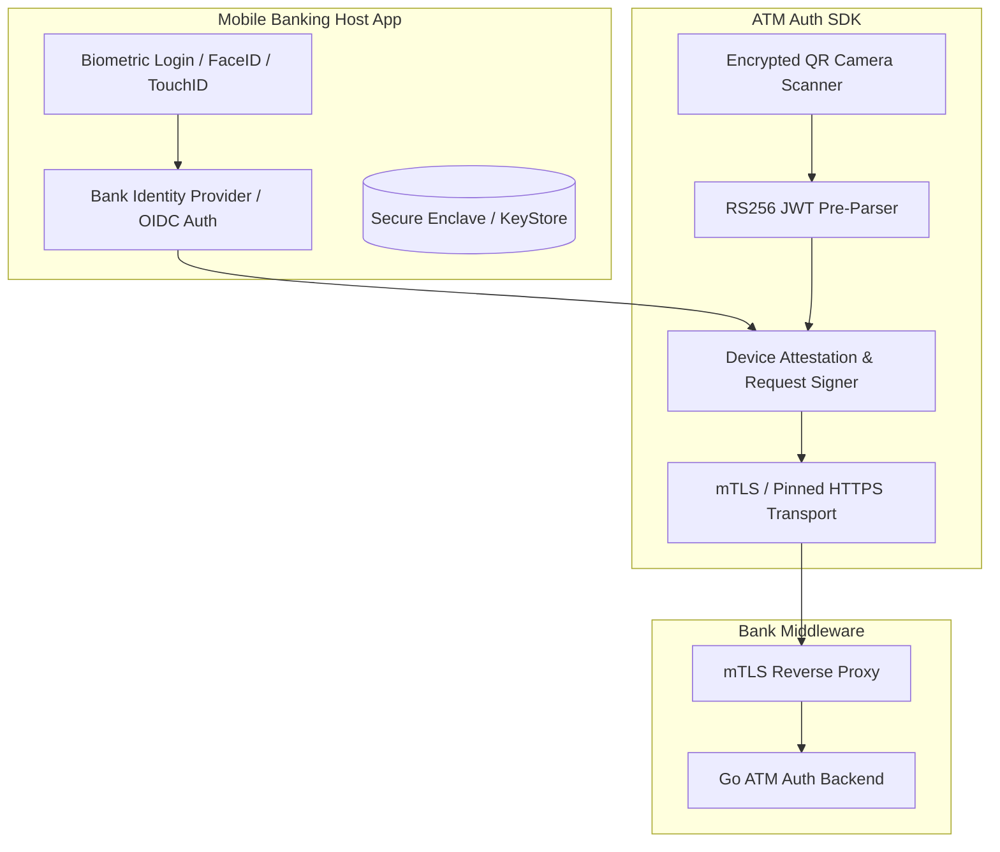

# Bank Mobile Integration SDK Specification (v1.0)
## Secure Cardless ATM QR Pre-Authorization SDK for Mobile Banking

---

## 1. Overview & Architectural Boundary

The **ATM Auth SDK** is designed to be embedded directly into a licensed financial institution's existing native iOS (`.xcframework`) or Android (`.aar`) mobile banking applications, or React Native / Flutter apps.



### Responsibility Split
* **Host Bank App owns:** Customer onboarding, Know Your Customer (KYC), account balance retrieval, biometric authentication (Face ID / Touch ID / BiometricPrompt), and Bank IdP OAuth2/OIDC token issuance.
* **ATM Auth SDK owns:** QR parsing, RS256 token verification, device attestation, cryptographic signature generation, certificate-pinned communication (`ENFORCE_HTTPS=true`), and atomic session approval.
* **Middleware owns:** Real-time WebSocket push to ATM, Redis Lua atomic single-winner state machine, SIEM audit ingestion, and terminal session consumption.

---

## 2. Security Controls & MASVS Compliance

The SDK conforms to OWASP Mobile Application Security Verification Standard (MASVS-L2):

1. **Memory-Only Token Lifespan:** The parsed `qrToken` is held in volatile RAM only (`SecureString` / zeroized byte array) and wiped immediately after approval submission or upon app backgrounding.
2. **Screen Shielding:** Android `FLAG_SECURE` and iOS `UITextField.isSecureTextEntry` canvas masking prevent screenshotting, screen-recording, or memory dumping via ADB.
3. **Root & Jailbreak Detection:** Hardware-backed root/tamper heuristics (checking for Magisk, Substrate, Frida runtime injection, test-keys, or modified bootloaders).
4. **Certificate Pinning:** Strict Subject Public Key Info (SPKI) SHA-256 hash pinning against the bank's production API gateway. Cleartext HTTP is rejected unconditionally.
5. **Hardware Device Enrolment:** Uses Android KeyStore / iOS Secure Enclave to sign transactions with an asymmetric hardware key generated during device enrollment.

---

## 3. SDK API Reference

### 3.1 Initialization
```typescript
import { AtmAuthSDK } from '@bank/atm-auth-sdk';

const sdk = new AtmAuthSDK({
  baseUrl: 'https://atm-gateway.bank.com',
  env: 'production',
  pinnedCertFingerprints: [
    'sha256/AAAAAAAAAAAAAAAAAAAAAAAAAAAAAAAAAAAAAAAAAAA=',
    'sha256/BBBBBBBBBBBBBBBBBBBBBBBBBBBBBBBBBBBBBBBBBBB=' // Backup rotation pin
  ],
  enforceHardwareAttestation: true,
});
```

### 3.2 Scan & Parse QR
```typescript
interface DecodedQR {
  sessionId: string;
  atmId: string;
  issuedAt: number;
  expiresAt: number;
}

// Scans physical QR displayed on ATM screen and cryptographically verifies claims
const qrPayload: DecodedQR = await sdk.parseAndValidateQR(rawScannedString);
```

### 3.3 Approve Session
```typescript
interface ApproveRequest {
  qrToken: string;
  idpBearerToken: string; // OIDC JWT issued by Bank's IdP
  customerAccountId: string;
  amountLimit?: number;
}

interface ApproveResponse {
  success: boolean;
  sessionId: string;
  authorizedAt: number;
  terminalId: string;
}

const result: ApproveResponse = await sdk.approveSession({
  qrToken: rawScannedString,
  idpBearerToken: hostAppSession.getOidcToken(),
  customerAccountId: "acc_987654321",
});
```

---

## 4. Error Codes & Recovery Playbook

| Error Code | HTTP Status | User Message | Action Required |
|---|---|---|---|
| `atm_mismatch` | `403 Forbidden` | "This QR code belongs to a different ATM terminal." | Re-scan the QR code currently displayed on the ATM screen. |
| `invalid_token` | `400 Bad Request` | "Security validation failed. Invalid QR code." | Reject transaction; ensure camera is scanning authentic screen. |
| `session_expired` | `410 Gone` | "ATM session has expired." | Press 'Refresh QR' on the ATM screen and scan again. |
| `session_not_pending` | `409 Conflict` | "Session already processed or cancelled." | Transaction was already approved or consumed. |
| `idp_token_required` | `401 Unauthorized` | "Session authentication required." | Re-authenticate with bank biometric login. |
| `rate_limited` | `429 Too Many Requests` | "Too many attempts. Please try again later." | Wait 5 minutes before retrying. |

---

## 5. Build Artifacts & Packaging
* **Android:** `com.bank.atm:auth-sdk:1.0.0@aar` (Target SDK 34, Min SDK 26)
* **iOS:** `AtmAuthSDK.xcframework` (iOS 15.0+, Swift 5.9, Bitcode disabled)
* **React Native / Expo:** `@bank/atm-auth-react-native` (native modules for KeyStore / SecureEnclave)
